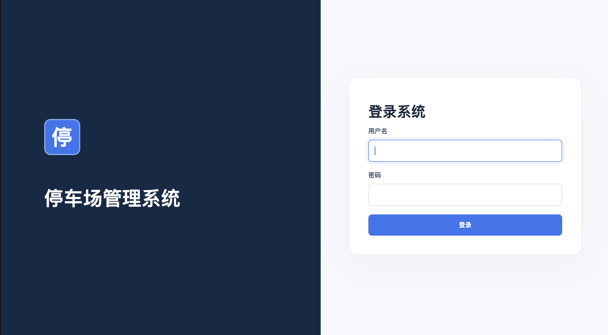
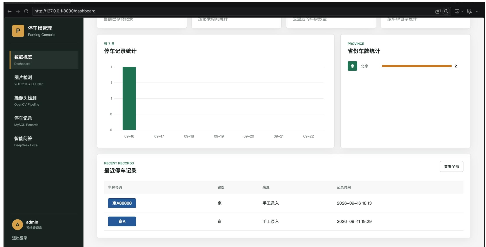
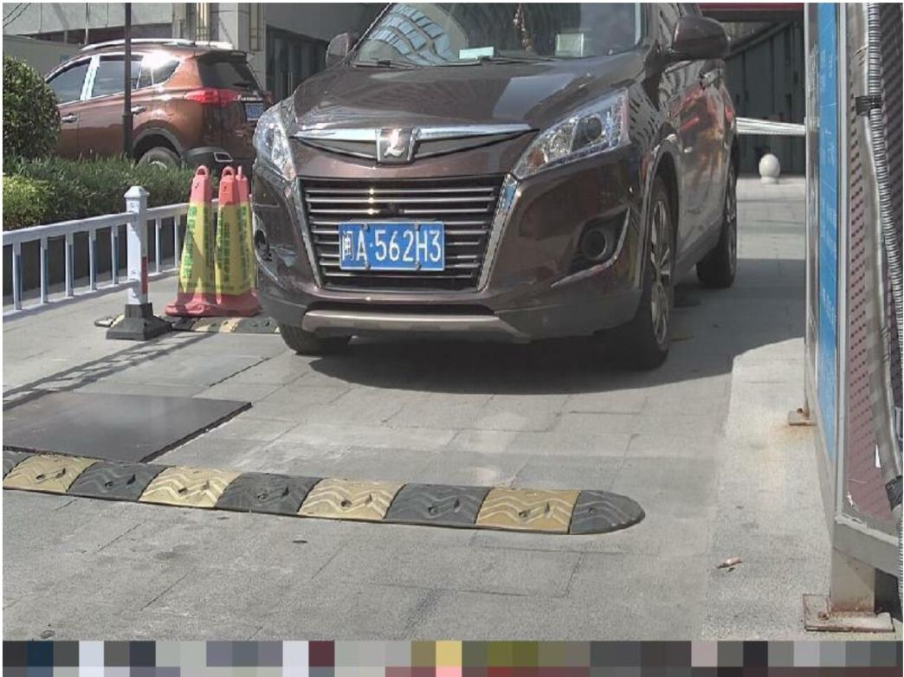
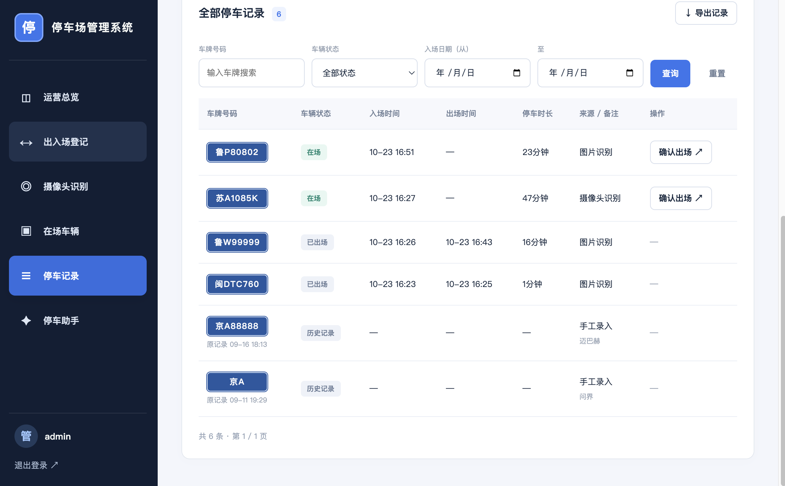
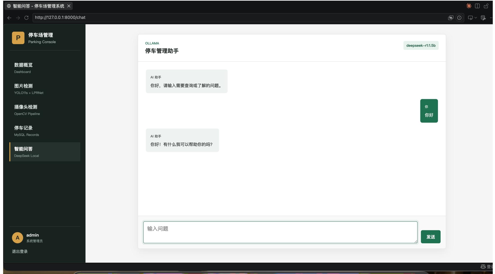

# 停车场管理系统

基于 FastAPI、MySQL、YOLO11s 和本地字符/颜色识别模型，提供车辆出入场、在场管理、停车记录、车位统计和停车助手。

## 功能

- 图片、摄像头识别车牌及颜色；支持修改识别结果，再确认入场或出场。
- 手工登记入场与出场；同车在场禁止重复入场，满位禁止入场，没有在场记录时提示人工处理。
- 在场车辆列表、入场时间与已停时长；一次停车对应一条记录，出场时更新该记录。
- 按车牌、状态、入场日期查询，分页展示，按当前筛选条件导出全部 CSV 记录。
- 设置停车场总车位，首页展示今日入场、今日出场、当前在场、剩余车位及近七日趋势。
- 停车助手直接读取数据库回答车位、进出场数量和完整车牌状态；其他问题使用带实时停车快照的本地 Ollama。
- 助手不修改停车数据，识别结果也不会未经确认自动登记；暂不包含计费、支付或道闸控制。

## 系统展示

### 登录页面

管理员登录后进入停车管理工作台。



### 运营总览

展示今日入场、今日出场、当前在场、剩余车位，以及近七日入场趋势和车位使用情况。



### 车牌识别与出入场登记

上传车辆图片，查看车牌号码、颜色及置信度，核对或修改车牌后确认入场、出场。



### 停车记录

按车牌、车辆状态和入场日期筛选记录，查看进出场时间与停车时长，并支持导出记录。



### 停车助手

围绕停车场数据和登记操作进行问答，支持查询剩余车位、进出场数量和车辆在场状态。



## 首次启动指南

以下步骤面向第一次在自己电脑上运行项目的使用者。所有命令均在项目根目录执行，也就是包含 `requirements.txt` 和 `app` 文件夹的目录。

### 1. 准备运行环境与项目文件

- 安装 Python 3.10 或以上版本，并确认终端能够运行 Python。
- 安装并启动 MySQL 服务，准备好数据库用户名、密码和端口。
- 获取完整项目，可以通过 Git 克隆或解压项目压缩包。
- Ollama 为可选服务，可以先完成停车系统启动，再配置智能咨询。

先检查 Python：

```bash
# macOS / Linux
python3 --version
```

```bat
REM Windows CMD
python --version
```

确认以下文件存在，且模型权重不是空文件或下载链接文本：

```text
app/                               后端、页面与静态资源
recognize/model.py                 识别网络、图像预处理和解码
recognize/service.py               检测与识别服务
recognize/plate_rec_color.pth       车牌字符及颜色识别权重
runs/license_plate/weights/best.pt  车牌检测权重
requirements.txt                   Python 依赖清单
.env.example                       配置模板
```

仅运行系统时，不需要 `CLPD`、`dataset`、训练脚本、根目录 `yolo11s.pt` 或 `last.pt`。请在自己的电脑上新建虚拟环境，无需复制他人的 `.venv`。

### 2. 创建虚拟环境并安装依赖

macOS / Linux：

```bash
python3 -m venv .venv
source .venv/bin/activate
python -m pip install -r requirements.txt
```

Windows CMD（以下命令在命令提示符中执行）：

```bat
python -m venv .venv
.venv\Scripts\activate.bat
python -m pip install -r requirements.txt
python -m pip install tzdata
```

Windows 额外安装 `tzdata`，供系统读取 `Asia/Shanghai` 时区。首次安装依赖需要联网，PyTorch 等依赖较大，请等待安装完成。

### 3. 创建自己的 .env 配置文件

系统只加载项目根目录中的 `.env`。`.env.example` 是参考模板，不会自动参与运行配置。
在新环境中先复制模板；如果目录中已经有 `.env`，先检查其中配置，避免直接覆盖。

macOS / Linux：

```bash
cp .env.example .env
```

Windows CMD：

```bat
copy .env.example .env
```

编辑 `.env`，至少设置以下内容。当前模板未列出 `MYSQL_PASSWORD`，请自行添加这一行：

```dotenv
SECRET_KEY=替换为下面命令生成的随机字符串

MYSQL_HOST=127.0.0.1
MYSQL_PORT=3306
MYSQL_USER=root
MYSQL_PASSWORD="填写自己电脑上的MySQL密码"
MYSQL_DATABASE=Paking_Car_Sysetem

ADMIN_USERNAME=admin
ADMIN_PASSWORD="设置自己的系统管理员密码"

DETECTION_MODEL_PATH=runs/license_plate/weights/best.pt
RECOGNITION_MODEL_PATH=recognize/plate_rec_color.pth
INFERENCE_DEVICE=auto
```

在已激活的虚拟环境中生成 `SECRET_KEY`，将输出粘贴到对应配置项：

```bash
python -c "import secrets; print(secrets.token_hex(32))"
```

配置说明：

- `MYSQL_USER`、`MYSQL_PASSWORD` 用于连接 MySQL；`ADMIN_USERNAME`、`ADMIN_PASSWORD` 用于登录停车系统，两套账号作用不同。
- 默认数据库名称为 `Paking_Car_Sysetem`，请按此名称填写；也可以自行指定其他数据库名。
- MySQL 使用其他端口时，同步修改 `MYSQL_PORT`。密码中的特殊字符应放在引号内。
- 模型路径默认相对于项目根目录，也可以填写本机绝对路径。CPU 可以完成推理，无需先安装 CUDA；需要固定使用 CPU 时设置 `INFERENCE_DEVICE=cpu`。
- 文件名必须是 `.env`，请避免保存成 `.env.txt`。
- 配置优先级为：已有的系统或终端环境变量、`.env`、代码中的默认值。修改 `.env` 后应重启后端。

### 4. 确认 MySQL 连接与自动初始化方式

先启动本机 MySQL 服务。如果安装了 MySQL 命令行客户端，可测试连接：

```bash
mysql -h 127.0.0.1 -P 3306 -u root -p
```

按提示输入 MySQL 密码。使用其他用户名或端口时请调整命令，也可通过数据库管理工具测试连接。

当前项目通过应用自动初始化数据库，无需手工创建表或导入 SQL 文件。启动时会执行：

1. 创建 `.env` 中指定的数据库（不存在时）。
2. 创建 `users`、`parking_records`、`parking_settings` 三张数据表及索引。
3. 按管理员配置创建账号，同名账号已存在时保留原密码。
4. 在车位设置不存在时初始化 100 个车位，后续可在页面调整。

`app/models.py` 定义数据库表与 Python 对象的映射，`app/database.py` 负责连接、会话和初始化，这两个文件均需保留。
当前启动流程每次都会检查数据库，所用 MySQL 账号需要建库、建表及日常读写权限。升级旧版本还需要增加字段和索引的权限。

### 5. 启动后端并登录

在项目根目录、已激活的虚拟环境中执行：

```bash
python -m uvicorn app.main:app --reload
```

终端出现服务监听地址后，在本机浏览器打开 [http://127.0.0.1:8000](http://127.0.0.1:8000)。
终端保持运行，使用 `.env` 中设置的系统管理员账号登录。若未修改模板账号，默认用户名为 `admin`，密码为 `admin123`。
还需检查终端是否有“数据库初始化或升级失败”：即使网页服务启动，数据库异常也会影响登录和业务功能。

登录后可进行以下检查：

1. 打开运营总览和停车记录页面，确认数据库功能正常。
2. 上传一张包含车牌的图片，点击“开始识别”，检查检测和识别结果。
3. 核对车牌后确认入场，在“在场车辆”查看记录，再确认出场。

模型在第一次识别时加载，首次请求可能比后续请求更慢。停止服务时，在运行终端按 `Ctrl+C`。

### 6. 可选：启用 Ollama 智能咨询

车辆入出场、图片识别、统计查询，以及停车助手中的基础车位和完整车牌状态问答，可以先在不启动 Ollama 的情况下使用。
其他智能咨询需要另外安装并启动 Ollama 服务，然后下载与配置一致的模型：

```bash
ollama pull deepseek-r1:1.5b
```

保持 Ollama 服务运行。如果使用命令行启动服务，可在另一个终端执行 `ollama serve`；桌面应用已经启动服务时，无需再次运行。
确认 `.env` 配置与实际服务一致：

```dotenv
OLLAMA_BASE_URL=http://127.0.0.1:11434
OLLAMA_MODEL=deepseek-r1:1.5b
```

若使用其他已安装模型，修改 `OLLAMA_MODEL` 后重启后端。Ollama 不可用时，系统会提示智能咨询暂不可用。

## 后续再次启动

依赖和配置完成后，通常只需启动 MySQL、激活虚拟环境，再运行后端。使用智能咨询时同时启动 Ollama。

macOS / Linux：

```bash
source .venv/bin/activate
python -m uvicorn app.main:app --reload
```

Windows CMD：

```bat
.venv\Scripts\activate.bat
python -m uvicorn app.main:app --reload
```

不需要每次重建虚拟环境或复制 `.env`。项目依赖发生变化时再重新安装 `requirements.txt`。

## 常见启动问题

| 问题 | 处理方式 |
| --- | --- |
| `Address already in use` 或端口被占用 | 检查是否已运行服务，或用 `python -m uvicorn app.main:app --reload --port 8001` 启动，再访问 `http://127.0.0.1:8001`。 |
| `No module named ...` | 确认已激活项目虚拟环境，再执行 `python -m pip install -r requirements.txt`。 |
| 数据库连接失败或 `Access denied` | 检查 MySQL 是否启动，核对 `.env` 的主机、端口、用户名、密码及账号权限。 |
| 修改管理员配置后仍无法登录 | 已存在的同名账号不会重置密码；使用原密码，或修改 `ADMIN_USERNAME` 后重启以创建另一个管理员。 |
| 提示模型文件不存在 | 检查两个权重文件及 `.env` 中的模型路径，保留 `recognize/model.py` 和 `recognize/service.py`。 |
| CUDA / MPS 推理异常 | 将 `.env` 的 `INFERENCE_DEVICE` 改为 `cpu`，重启后重试。 |
| Windows 提示找不到 `Asia/Shanghai` 时区 | 在虚拟环境中执行 `python -m pip install tzdata`，然后重启后端。 |
| 摄像头无法打开 | 使用本机 `localhost`、`127.0.0.1` 或 HTTPS 地址，允许浏览器访问摄像头，并检查设备是否被占用。 |
| 智能咨询提示服务暂不可用 | 检查 Ollama 是否运行，确认模型已下载、模型名和服务地址与 `.env` 一致。 |

`--reload` 用于本地开发和演示。以上默认地址供运行系统的电脑本机访问，其他电脑需要在自己的环境中安装，或另外配置局域网服务访问。

## 向他人提供项目

- 提供应用代码、依赖清单、配置模板及两个运行权重。
- 对方按本指南创建自己的 `.env`，填写自己的数据库连接和管理员配置。
- 分享前检查压缩包及 Git 跟踪内容，避免包含实际 `.env`、本机虚拟环境、数据库备份或用户上传结果。
- `.gitignore` 不会自动取消对已跟踪文件的跟踪，不能仅凭忽略规则判断 `.env` 未被提交。

## 使用流程

1. 在“出入场登记”上传图片，或在“摄像头识别”截帧。
2. 核对、修改车牌，点击“确认入场”或“确认出场”。无法识别时，可在“在场车辆”页手工登记。
3. 在“在场车辆”查看当前车辆并确认出场，在“停车记录”查询历史或导出 CSV。
4. 在在场车辆或停车记录页面设置总车位数（初始 100）；不可小于当前在场车辆数。
5. 问停车助手“现在还剩多少车位？”“今天进出了多少辆车？”或“粤B12345 在场吗？”。

日期、进出场时间按 Asia/Shanghai 记录。日期筛选按入场日期，已停时长在页面刷新时更新。
CSV 使用 UTF-8 BOM 编码，适合 Excel 打开；导出遵循筛选条件，包含全部匹配记录，而不只当前页。

## 旧数据兼容

首次升级启动时，在旧停车记录表增加可空的入场时间、出场时间和在场唯一标记，并创建车位设置表。
不会删除或覆盖原车牌、来源、备注和记录时间。旧数据没有入场状态，因此显示为“历史记录”，不计入在场或今日进出场统计。
可使用“历史记录”筛选查看；日期筛选对旧数据使用原记录时间。请在升级前按日常维护习惯备份数据库，并确保数据库账号有建表、增加字段和索引权限。

## 项目结构

```text
app/
  main.py                 应用入口、页面、统计和查询
  config.py               环境配置
  database.py             连接、初始化与兼容升级
  models.py               用户、停车记录、车位设置数据表
  parking.py              时间、车牌校验、停车统计和查询公共规则
  auth.py                 登录状态辅助函数
  api/                    登录、检测、出入场、导出与停车助手接口
  templates/              页面与公共记录表格
  static/                 页面样式及交互脚本
recognize/
  model.py                字符/颜色识别网络、预处理和解码
  service.py              模型加载、YOLO定位、裁剪与联合识别
  plate_rec_color.pth      字符及颜色识别权重
runs/license_plate/weights/best.pt  当前车牌检测权重
scripts/                  数据准备、训练、识别评估
CLPD/                     原始图片与标注
dataset/                  训练/验证/测试数据
```

## 模型及配置

当前检测模型是已训练的 YOLO11s `runs/license_plate/weights/best.pt`，识别模型是 `recognize/plate_rec_color.pth`，支持 78 类字符、5 类颜色。
网络和输入契约参考[上游识别实现](https://github.com/we0091234/yolov8-plate/tree/master/plate_recognition)，按 checkpoint cfg 构建并严格加载。
模型置信度不代表经校准的准确率。

复制 `.env.example` 后，在实际使用的 `.env` 中可设置：

- `DETECTION_MODEL_PATH`、`RECOGNITION_MODEL_PATH`：模型路径，相对于项目根目录或使用绝对路径。
- `INFERENCE_DEVICE`：默认 `auto`，按 CUDA / MPS / CPU 自动选择，也可指定 `cpu`。
- `DETECTION_CONFIDENCE`、`DETECTION_IMAGE_SIZE`：默认 0.25、1024。
- `MAX_UPLOAD_MB`：默认 10，最大图片分辨率为 2000 万像素。
- `OLLAMA_BASE_URL`、`OLLAMA_MODEL`：本地问答服务与模型。
- `PARKING_RUNTIME_DIR`：默认系统临时目录下 `parking_management_system`，结果图保存在其中的 `results/`，可按部署需要定期清理。

摄像头需要 HTTPS 或 localhost，并由用户授权浏览器访问。连续识别每次请求完成后间隔一秒，编辑识别结果时停止连续模式。
模型首次识别时加载并在进程内复用。

## 数据准备与评估

```bash
python scripts/prepare_dataset.py --output /tmp/parking-dataset
python scripts/evaluate_recognition.py --limit 30 --output /tmp/recognition-evaluation.json
```

数据准备拒绝覆盖已有目录。训练脚本默认读取项目 `dataset/data.yaml`，使用根目录 `yolo11s.pt` 预训练权重；`last.pt` 保留用于继续训练。

本项目供学习交流使用。
